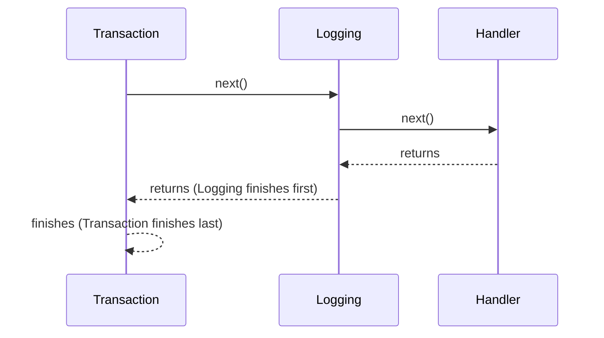

A decorator is a non-generic pipeline behavior that wraps handler execution — logging,
transactions, validation, and similar cross-cutting concerns. "Non-generic" means one
decorator class can wrap any number of unrelated request/command/query/stream/notification
types, unlike a handler, which is written against one specific message type.

## One interface per message kind, plus a response variant

| Message kind | Decorator interface |
|---|---|
| `IRequest` (no response) | `IRequestDecorator` |
| `IRequest<TResponse>` | `IRequestDecorator.WithResponse` |
| `ICommand` (no response) | `ICommandDecorator` |
| `ICommand<TResponse>` | `ICommandDecorator.WithResponse` |
| `IQuery<TResponse>` | `IQueryDecorator` |
| `IStreamRequest<TResponse>` | `IStreamRequestDecorator` |
| `INotification` | `INotificationDecorator` |

A class can implement both the no-response and `WithResponse` variants of a kind at once
(the README's `LoggingDecorator` example implements both `IRequestDecorator` and
`IRequestDecorator.WithResponse`), letting one decorator wrap every shape of that kind.

Take `IRequestDecorator` as an example. The interface itself isn't generic; its
`HandleAsync` method is, and that's what lets one decorator wrap any request type:

```csharp
public interface IRequestDecorator
{
    Task HandleAsync<TRequest>(TRequest request, RequestHandlerDelegate next,
        CancellationToken cancellationToken) where TRequest : IRequest;
}
```

## Ordering is outer-to-inner by declaration order

When decorators are attached to a handler — via `x.Decorator.With<T>()` calls (manual
registration) or `[DecorateWith<T1, T2, ...>]` (generated registration) — the first one
listed is the outermost layer, and runs first and last. Each subsequent one is nested
inside it.

With decorators added as `.With<TransactionDecorator>().With<LoggingDecorator>()` (or the
attribute equivalent `[DecorateWith<TransactionDecorator, LoggingDecorator>]`),
`TransactionDecorator` starts first, calls `next()`, which runs `LoggingDecorator`, which
calls `next()`, which runs the handler — then both decorators complete in reverse (inner to
outer):



## Two ways to attach decorators

- **Manual**: `x.Decorator.With<T>()`, chained in the desired outer-to-inner order, passed to
  the `configure` delegate of `AddRequestHandler`/`AddCommandHandler`/`AddQueryHandler`/
  `AddStreamRequestHandler`, or (for notifications) to a handler entry's own `configure`
  delegate inside `AddNotificationHandler`.
- **Generated**: `[DecorateWith<T1, ..., T8>]` on the handler class, validated at compile
  time against the decorator interface the handler's kind requires. Arities 1 through 8 are
  available; apply at most one `[DecorateWith<...>]` attribute per handler class.

The two forms line up 1:1:

```csharp
// Manual
x.Decorator.With<TransactionDecorator>().With<LoggingDecorator>();

// Generated (same outer-to-inner order)
[DecorateWith<TransactionDecorator, LoggingDecorator>]
public sealed class GetOrderHandler : IRequestHandler<GetOrder, OrderDto> { /* ... */ }
```

See [Using decorators](../guides/using-decorators.md) for worked examples of both.
