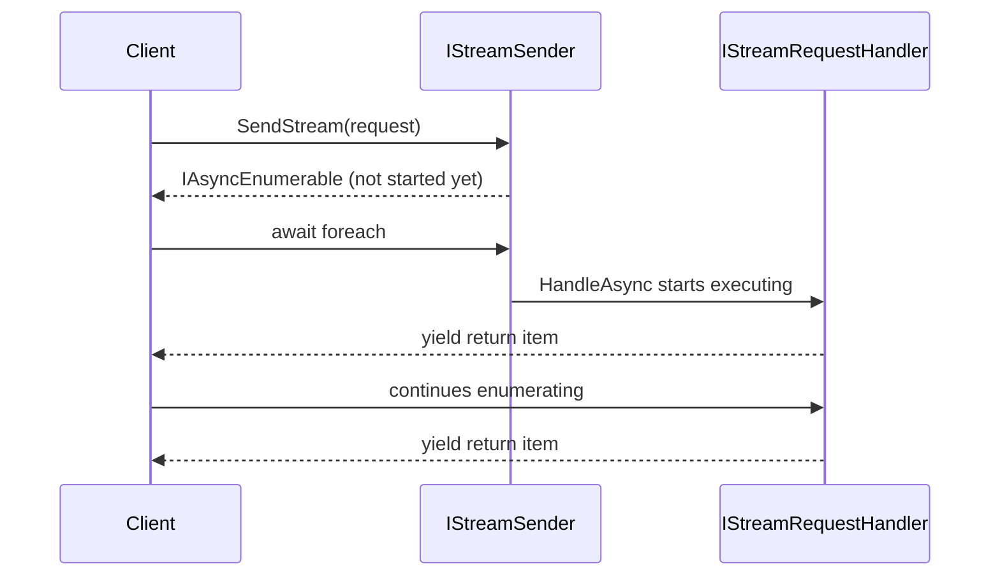

## Three independent message kinds

Davish.Sendr has three kinds of message contracts, all dispatched through `ISender`:

- `IRequest` / `IRequest<TResponse>` — general request/response.
- `ICommand` / `ICommand<TResponse>` — explicit CQRS command contracts.
- `IQuery<TResponse>` — explicit CQRS query contracts.

`ICommand`/`IQuery` are independent of `IRequest` — a command handler implements
`ICommandHandler`, not `IRequestHandler`. Each kind has its own handler interface,
`ISender.SendAsync` overload, registration method
(`AddRequestHandler`/`AddCommandHandler`/`AddQueryHandler`), and decorator interface. At the
call site, `ISender.SendAsync` picks the right overload from the argument's static type, so
callers don't need to know which kind a message belongs to.

`IStreamRequest<TResponse>` / `IStreamRequestHandler<TRequest, TResponse>` is the fourth
kind, dispatched through `IStreamSender` (which `ISender` also implements) and returning
`IAsyncEnumerable<TResponse>` instead of `Task`/`Task<TResponse>`.

Put the four side by side:

```csharp
public sealed record CreateOrder(Guid Id) : IRequest;              // no response
public sealed record PlaceOrder(Guid Id) : ICommand;                // no response, CQRS
public sealed record GetOrder(Guid Id) : IQuery<OrderDto>;           // CQRS, with a response
public sealed record ListOrders : IStreamRequest<OrderDto>;          // async stream
```

## One handler per request/response pair

Each of `IRequest`, `ICommand`, `IQuery`, and `IStreamRequest` allows exactly one registered
handler per request type (and, for the generic forms, per request/response type pair).
Registering a second handler for the same pair throws `InvalidOperationException` at
registration time. Dispatching a request with no registered handler also throws
`InvalidOperationException` — see [Exceptions and diagnostics](../reference/exceptions-and-diagnostics.md)
for the exact message. For streams, that happens when enumeration starts, not when
`SendStream` is called, since handling itself begins on enumeration (see below).

Each of those two throws maps to a line of code:

```csharp
builder.Services
    .AddSendr()
    .AddRequestHandler<CreateOrder, CreateOrderHandler>()
    .AddRequestHandler<CreateOrder, AnotherHandler>();
    // throws InvalidOperationException: CreateOrder already has a handler

// with no handler ever registered for GetOrder:
var order = await sender.SendAsync(new GetOrder(orderId));
// throws InvalidOperationException: no handler found for GetOrder
```

Registration captures the handler/decorator configuration immediately when the
`AddXHandler` call runs. Mutating the configuration object passed to a `configure` delegate
after that call has no effect.

## Streams start on enumeration

`IStreamRequestHandler.HandleAsync` returns an `IAsyncEnumerable<TResponse>`. Calling
`IStreamSender.SendStream` does not itself start executing the handler — execution begins
when the caller starts enumerating the returned sequence (`await foreach`, `MoveNextAsync`,
etc.), consistent with how any `IAsyncEnumerable` works.



## Two dispatch implementations, chosen once

`ISender`/`IStreamSender` (and separately, `IPublisher` for notifications — see
[Notification model](notification-model.md)) each have two mutually exclusive dispatch
implementations:

- The **default reflection-based sender**, populated by manual `AddRequestHandler` /
  `AddCommandHandler` / `AddQueryHandler` / `AddStreamRequestHandler` calls.
- The **generated, reflection-free sender**, installed by
  `AddSendr(o => o.UseGenerators())` from `Davish.Sendr.Generators`. See
  [Compile-time discovery](compile-time-discovery.md).

```csharp
// default: reflection sender
builder.Services.AddSendr();

// switch to the generated, reflection-free sender
builder.Services.AddSendr(o => o.UseGenerators());
```

Once `UseGenerators()` installs the generated sender, it only knows about handlers
discovered at compile time — manual `AddXHandler` calls made alongside it do not extend its
dispatch table. Pick one approach per application; a fully custom implementation can also be
installed via `SendrOptions.UseSender<TSender>()` (see [Extensibility](../reference/extensibility.md)).
