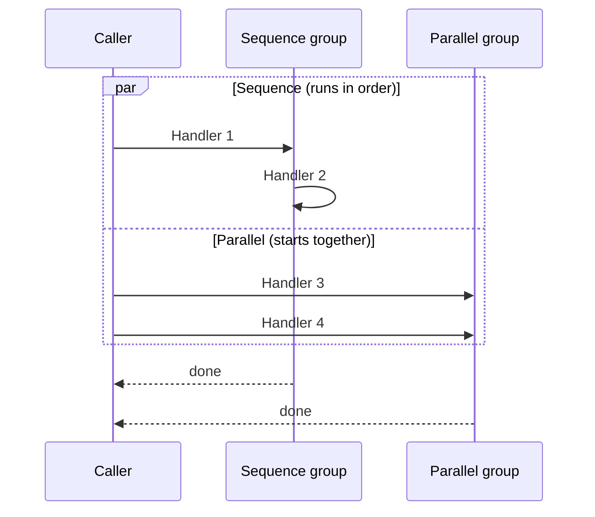

## Zero or more handlers, in two groups

Unlike a request/command/query (exactly one handler), an `INotification` can have any number
of handlers, including zero. `IPublisher.PublishAsync` with no registered handlers for the
notification's type is a no-op.

Handlers for a given notification type are organized into two named groups:

- **Sequence** — runs one handler at a time, in registration order. A handler that throws
  does not stop the remaining Sequence handlers from running.
- **Parallel** — starts every handler in the group concurrently.

The Sequence group and the Parallel group run concurrently *with each other* — a Parallel
handler does not wait for the Sequence group to finish, and vice versa:



`AddNotificationHandler<TNotification>` may be called only once per notification type, with
every handler for that type declared together in that one call, so the Sequence order is
explicit at a glance. A second call for the same type throws. As with handler registration
elsewhere in the library, the configuration is captured immediately; later mutation of the
object passed to `configure` has no effect.

## Exception aggregation

Every handler in both groups still runs, even after an earlier handler in the same group
fails. `PublishAsync` then reports failures as follows:

- Zero exceptions across both groups: no exception is thrown.
- Exactly one exception (from either group): it is rethrown as itself, with its original
  stack trace preserved — callers catching a specific exception type don't need to unwrap
  anything.
- Two or more exceptions (from either or both groups): combined into one
  `AggregateException` containing all of them.

```csharp
try
{
    await publisher.PublishAsync(new OrderPlaced(orderId), cancellationToken);
}
catch (AggregateException ex)
{
    // two or more exceptions: ex.InnerExceptions has all of them
}
catch (SomeSpecificException ex)
{
    // exactly one exception: it's the original type, no AggregateException to unwrap
}
```

This logic (`NotificationGroupRunner`) is shared by both the manual `AddNotificationHandler`
dispatch path and the code the source generator emits — see
[Compile-time discovery](compile-time-discovery.md) — so the aggregation contract is
identical either way.

## Handlers share the calling DI scope

Notification handlers resolve from the same DI scope as the code that calls `PublishAsync`.
Because Parallel handlers execute concurrently within that one scope, they must not share a
scoped service that isn't safe for concurrent use — a `DbContext` is the canonical example.
Sequence handlers don't have this concern, since they never run concurrently with each other
(they can still run concurrently with the Parallel group, which uses the same scope).

```csharp
// Don't do this: two Parallel handlers sharing the same scoped DbContext
public sealed class ReserveInventoryHandler(AppDbContext db) : INotificationHandler<OrderPlaced> { /* ... */ }
public sealed class UpdateStatsHandler(AppDbContext db) : INotificationHandler<OrderPlaced> { /* ... */ }
// If both are in the Parallel group, they hit the same DbContext instance concurrently
```

## Decorators on notification handlers

Each handler entry inside `AddNotificationHandler` can carry its own decorator pipeline via
`INotificationDecorator`, configured the same way as request/command/query decorators — see
[Decorator pipeline](decorator-pipeline.md) and
[Publishing notifications](../guides/publishing-notifications.md).
