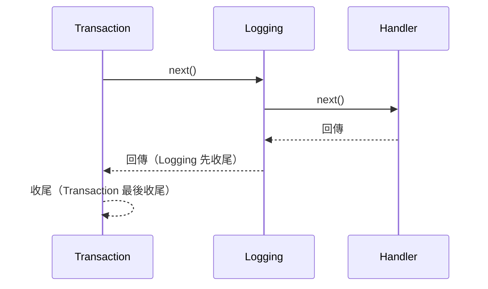

Decorator 是一個非泛型的 pipeline 行為，用來包裝 handler 的執行，像是記錄
（logging）、交易（transaction）、驗證等橫切關注點。「非泛型」的意思是：一個
decorator 類別可以包裝任意數量、彼此無關的 request/command/query/stream/notification
型別，這點跟 handler 不同：handler 是針對某一個特定訊息型別寫的。

## 每種訊息各自一個介面，外加一個有回應值的變體

| 訊息種類 | Decorator 介面 |
|---|---|
| `IRequest`（無回應值） | `IRequestDecorator` |
| `IRequest<TResponse>` | `IRequestDecorator.WithResponse` |
| `ICommand`（無回應值） | `ICommandDecorator` |
| `ICommand<TResponse>` | `ICommandDecorator.WithResponse` |
| `IQuery<TResponse>` | `IQueryDecorator` |
| `IStreamRequest<TResponse>` | `IStreamRequestDecorator` |
| `INotification` | `INotificationDecorator` |

一個類別可以同時實作某一種訊息的無回應值版本與 `WithResponse` 版本（README 裡的
`LoggingDecorator` 範例就同時實作了 `IRequestDecorator` 與
`IRequestDecorator.WithResponse`），讓一個 decorator 就能包裝這種訊息的所有形式。

以 `IRequestDecorator` 為例，介面本身不是泛型，但 `HandleAsync` 方法是泛型的，這就是
一個 decorator 能包裝任意 request 型別的原因：

```csharp
public interface IRequestDecorator
{
    Task HandleAsync<TRequest>(TRequest request, RequestHandlerDelegate next,
        CancellationToken cancellationToken) where TRequest : IRequest;
}
```

## 順序：依宣告順序，由外到內

無論是透過 `x.Decorator.With<T>()`（手動註冊），還是 `[DecorateWith<T1, T2, ...>]`
（產生出來的註冊），把 decorator 附加到 handler 上時，第一個列出的就是最外層，會最先
執行、最後結束。之後每一個都巢狀包在前一個裡面。

以 `.With<TransactionDecorator>().With<LoggingDecorator>()`（或等效的屬性寫法
`[DecorateWith<TransactionDecorator, LoggingDecorator>]`）加入 decorator 時，
`TransactionDecorator` 先開始執行，呼叫 `next()`，這會執行 `LoggingDecorator`，
它再呼叫 `next()`，才會執行 handler；執行完後，兩個 decorator 再依相反順序（由內到外）
收尾：



## 兩種附加 decorator 的方式

- **手動**：以想要的外到內順序串接 `x.Decorator.With<T>()`，傳給
  `AddRequestHandler`/`AddCommandHandler`/`AddQueryHandler`/`AddStreamRequestHandler`
  的 `configure` delegate，或者（對 notification 而言）傳給 `AddNotificationHandler`
  裡某個 handler 項目自己的 `configure` delegate。
- **產生出來的**：在 handler 類別上寫 `[DecorateWith<T1, ..., T8>]`，編譯期會依照該
  handler 所屬的訊息種類所需的 decorator 介面驗證。可用的 arity（型別參數個數）是 1 到
  8；每個 handler 類別最多只能套用一個 `[DecorateWith<...>]`。

兩種寫法順序是對應的：

```csharp
// 手動
x.Decorator.With<TransactionDecorator>().With<LoggingDecorator>();

// 產生出來的（同樣外到內）
[DecorateWith<TransactionDecorator, LoggingDecorator>]
public sealed class GetOrderHandler : IRequestHandler<GetOrder, OrderDto> { /* ... */ }
```

兩種方式的實際範例，見[使用 decorator](../guides/using-decorators.md)。
