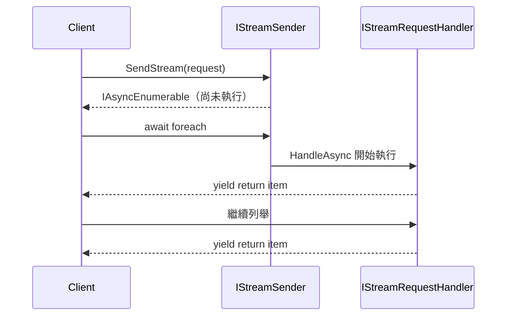

## 三種獨立的訊息分類

Davish.Sendr 把訊息合約分成三種，全部透過 `ISender` 分派：

- `IRequest` / `IRequest<TResponse>` — 一般的 request/response。
- `ICommand` / `ICommand<TResponse>` — 明確的 CQRS command 合約。
- `IQuery<TResponse>` — 明確的 CQRS query 合約。

`ICommand`/`IQuery` 與 `IRequest` 互相獨立：command 的 handler 實作 `ICommandHandler`，
不是 `IRequestHandler`。每一種都有自己的 handler 介面、`ISender.SendAsync` 多載、
註冊方法（`AddRequestHandler`/`AddCommandHandler`/`AddQueryHandler`），以及 decorator
介面。在呼叫端，`ISender.SendAsync` 會依引數的靜態型別自動選對多載，呼叫端不需要知道
某個訊息屬於哪一種。

`IStreamRequest<TResponse>` / `IStreamRequestHandler<TRequest, TResponse>` 是第四種，
透過 `IStreamSender`（`ISender` 也實作了這個介面）分派，回傳的是
`IAsyncEnumerable<TResponse>`，而不是 `Task`/`Task<TResponse>`。

四種放在一起看：

```csharp
public sealed record CreateOrder(Guid Id) : IRequest;             // 無回應值
public sealed record PlaceOrder(Guid Id) : ICommand;               // 無回應值，CQRS
public sealed record GetOrder(Guid Id) : IQuery<OrderDto>;          // CQRS，有回應值
public sealed record ListOrders : IStreamRequest<OrderDto>;         // async stream
```

## 每個 request/response 組合只能有一個 handler

`IRequest`、`ICommand`、`IQuery`、`IStreamRequest` 這四種，每個 request 型別（對於
泛型形式，則是每個 request/response 型別組合）都只允許註冊恰好一個 handler。為同一組合
註冊第二個 handler，會在註冊時就丟出 `InvalidOperationException`。分派一個沒有註冊
handler 的 request，同樣會丟出 `InvalidOperationException`。詳細訊息見
[例外與診斷](../reference/exceptions-and-diagnostics.md)。對 stream 來說，這件事發生在
開始列舉（enumerate）時，而不是呼叫 `SendStream` 時，因為處理本身就是從列舉開始才啟動
（見下方說明）。

兩種情況各自對應到一段程式碼：

```csharp
builder.Services
    .AddSendr()
    .AddRequestHandler<CreateOrder, CreateOrderHandler>()
    .AddRequestHandler<CreateOrder, AnotherHandler>();
    // 丟出 InvalidOperationException：CreateOrder 已經有 handler 了

// 完全沒有為 GetOrder 註冊過 handler 的情況下：
var order = await sender.SendAsync(new GetOrder(orderId));
// 丟出 InvalidOperationException：找不到 GetOrder 的 handler
```

註冊時，handler/decorator 的設定會在呼叫 `AddXHandler` 那一刻就被立即擷取下來。之後再去
修改傳給 `configure` delegate 的設定物件，不會產生任何效果。

## Stream 從列舉開始才執行

`IStreamRequestHandler.HandleAsync` 回傳的是 `IAsyncEnumerable<TResponse>`。呼叫
`IStreamSender.SendStream` 本身並不會開始執行 handler，執行是從呼叫端開始列舉回傳序列
時才開始（`await foreach`、`MoveNextAsync` 等），這與任何 `IAsyncEnumerable` 的行為一致。



## 兩套分派實作，二選一

`ISender`/`IStreamSender`（以及另外，notification 用的 `IPublisher`，見
[Notification 模型](notification-model.md)）各自有兩套互斥的分派實作：

- **預設的反射式 sender**，由手動呼叫 `AddRequestHandler`/`AddCommandHandler`/
  `AddQueryHandler`/`AddStreamRequestHandler` 填入內容。
- **產生出來的 reflection-free sender**，由 `Davish.Sendr.Generators` 的
  `AddSendr(o => o.UseGenerators())` 安裝。見[編譯期發現](compile-time-discovery.md)。

```csharp
// default: reflection sender
builder.Services.AddSendr();

// 換成產生出來的 reflection-free sender
builder.Services.AddSendr(o => o.UseGenerators());
```

一旦 `UseGenerators()` 安裝了產生出來的 sender，它就只認得編譯期發現的 handler。跟它
並存的手動 `AddXHandler` 呼叫，不會擴充它的分派表。每個應用程式只能選一種方式；也可以透過
`SendrOptions.UseSender<TSender>()`（見[擴充性](../reference/extensibility.md)）安裝完全
自訂的實作。
