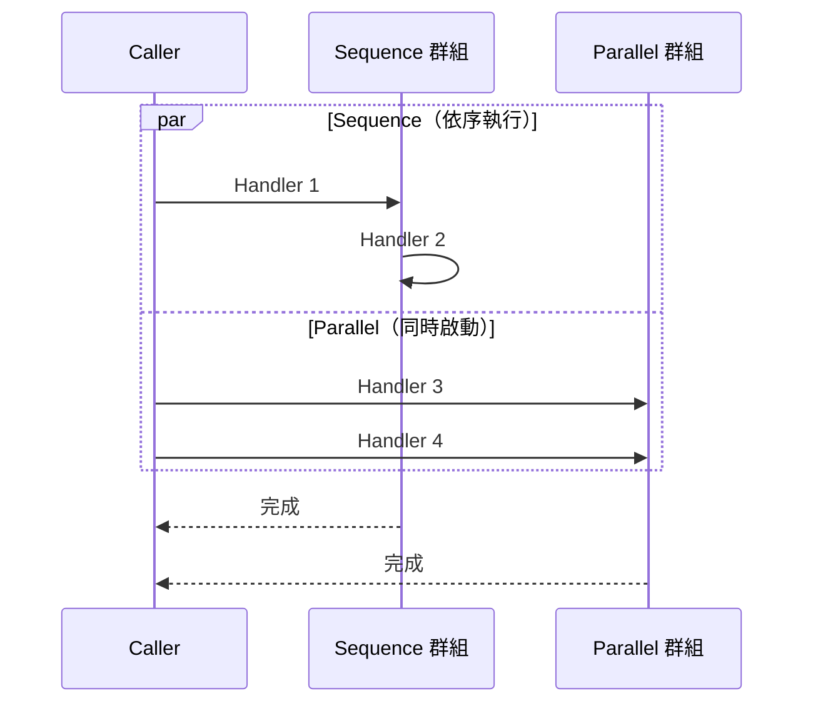

## 零個或多個 handler，分成兩個群組

跟 request/command/query（恰好一個 handler）不同，`INotification` 可以有任意數量的
handler，包括零個。若 `IPublisher.PublishAsync` 發佈的 notification 型別沒有任何已註冊
的 handler，這就是一個 no-op（什麼都不會發生）。

某個 notification 型別的 handler 會被組織成兩個命名群組：

- **Sequence（序列）** — 依註冊順序，一次執行一個 handler。某個 handler 丟出例外，
  不會阻止 Sequence 群組裡剩下的 handler 繼續執行。
- **Parallel（平行）** — 群組內所有 handler 同時啟動。

Sequence 群組與 Parallel 群組彼此是**同時**執行的。Parallel 的 handler 不會等
Sequence 群組跑完才開始，反過來也一樣：



`AddNotificationHandler<TNotification>` 對同一個 notification 型別只能呼叫一次，該
型別所有的 handler 都要在那一次呼叫裡一起宣告，這樣 Sequence 的順序才會一眼可見。
第二次呼叫會丟出例外。跟這個函式庫其他地方的 handler 註冊一樣，設定會被立即擷取下來；
之後修改傳給 `configure` 的物件不會有任何效果。

## 例外聚合規則

即使前面的 handler 失敗了，同一個群組裡的每個 handler 仍然都會執行。`PublishAsync`
接著依下列規則回報失敗：

- 兩個群組加起來零個例外：不會丟出任何例外。
- 剛好一個例外（不論來自哪個群組）：會原樣重新丟出，並保留原始的堆疊追蹤（stack
  trace），呼叫端要攔截特定例外型別時，不需要多做任何解包（unwrap）動作。
- 兩個以上的例外（不論來自哪個或兩個群組）：會合併成一個包含全部例外的
  `AggregateException`。

```csharp
try
{
    await publisher.PublishAsync(new OrderPlaced(orderId), cancellationToken);
}
catch (AggregateException ex)
{
    // 兩個以上的例外：ex.InnerExceptions 包含全部
}
catch (SomeSpecificException ex)
{
    // 剛好一個例外：直接是原本的型別，不用先拆 AggregateException
}
```

這套邏輯（`NotificationGroupRunner`）同時被手動的 `AddNotificationHandler` 分派路徑，
以及 source generator 產生出來的程式碼共用（見[編譯期發現](compile-time-discovery.md)），
所以兩種方式的聚合規則完全一致。

## Handler 共用呼叫端的 DI scope

Notification handler 是從呼叫 `PublishAsync` 那段程式碼所在的同一個 DI scope 解析出來
的。因為 Parallel handler 會在同一個 scope 內同時執行，它們**不能**共用一個不支援並行
存取的 scoped 服務：`DbContext` 就是典型的例子。Sequence handler 沒有這個顧慮，因為
它們彼此永遠不會同時執行（但仍可能與 Parallel 群組同時執行，兩者用的是同一個 scope）。

```csharp
// 不要這樣做：兩個 Parallel handler 共用同一個 scoped DbContext
public sealed class ReserveInventoryHandler(AppDbContext db) : INotificationHandler<OrderPlaced> { /* ... */ }
public sealed class UpdateStatsHandler(AppDbContext db) : INotificationHandler<OrderPlaced> { /* ... */ }
// 如果兩個都放進 Parallel 群組，會同時對同一個 DbContext 實例發出查詢/寫入
```

## Notification handler 上的 decorator

`AddNotificationHandler` 裡的每一個 handler 項目，都可以透過 `INotificationDecorator`
帶上自己的 decorator pipeline，設定方式跟 request/command/query 的 decorator 一樣（見
[Decorator pipeline](decorator-pipeline.md)與
[發佈 notification](../guides/publishing-notifications.md)）。
